# ReThread: A Digital Marketplace for Textile Surplus in Pakistan

**Project report draft**  
**Project repository name:** ReSourcePK  
**Product name:** ReThread  
**Prepared:** 8 November 2026  
**Version:** Working draft — team and institution details to be completed

> **Draft note:** This report describes the implementation found in the paired backend and frontend repositories as of the preparation date, plus the payment sandbox flow exercised by the team. Replace bracketed fields, verify the current test/deployment evidence, and review the proposed financial model before submitting or sharing as a final report. Do not add live credentials, passwords, private customer information, or production database URLs.

## Table of contents

1. [Abstract](#1-abstract)
2. [Introduction and background](#2-introduction-and-background)
3. [Problem statement](#3-problem-statement)
4. [Existing solutions and comparison](#4-existing-solutions-and-comparison)
5. [Project aim, objectives, and scope](#5-project-aim-objectives-and-scope)
6. [Proposed solution and beneficiaries](#6-proposed-solution-and-beneficiaries)
7. [Requirements and user roles](#7-requirements-and-user-roles)
8. [Features and user interaction](#8-features-and-user-interaction)
9. [System design](#9-system-design)
10. [Implementation and technology](#10-implementation-and-technology)
11. [Payment module](#11-payment-module)
12. [Financial and operating model](#12-financial-and-operating-model)
13. [Testing, results, and evaluation](#13-testing-results-and-evaluation)
14. [Screenshots and figure placeholders](#14-screenshots-and-figure-placeholders)
15. [Limitations, risks, and future work](#15-limitations-risks-and-future-work)
16. [Conclusion](#16-conclusion)
17. [References](#17-references)
18. [Appendices](#18-appendices)

## 1. Abstract

ReThread is a business-to-business marketplace concept for connecting textile surplus sellers with buyers in Pakistan. The project responds to the difficulty of discovering, evaluating, and purchasing available surplus materials through a single trusted workflow. The platform provides published material listings, seller and listing review, buyer requirements and matching, direct orders, pooled group purchases, team permissions, operational dashboards, and hosted payment checkout.

The application is implemented as a React frontend and a Node.js/Express backend backed by PostgreSQL. The backend controls user access, listing visibility, order prices, inventory reservations, and payment state. RapidGateway hosted checkout is integrated in TEST mode; a verified signed webhook, rather than a browser redirect, is required before an order is recorded as paid. This report describes the current implementation, intended users, user journeys, comparison with selected existing services, testing boundaries, and future work. It does not claim measured environmental impact or live payment acceptance. **[Team: revise this abstract after final evaluation and insert verified results.]**

**Keywords:** textile surplus, deadstock, circular economy, B2B marketplace, group purchasing, Pakistan, hosted checkout.

## 2. Introduction and background

Textile businesses can hold usable leftover material after production, while smaller manufacturers and designers may need material in quantities or price ranges that are difficult to source through conventional channels. When reliable information about material type, quantity, quality, location, and price is hard to find, potential reuse or resale can be delayed or missed. This project focuses on improving discovery and transaction coordination for surplus textile material.

Pakistan has a large and geographically distributed textile and garment sector. A British Council Pakistan study identifies Lahore, Karachi, and Faisalabad as apparel production hubs and describes fabric waste and deadstock as by-products of garment production [4]. It also documents existing cut-piece resale and the role of local tailors and home sewing in using such material. This gives ReThread a concrete local context: the platform could help suppliers publish usable surplus and help smaller workshops find it.

A 2025 statement published by Pakistan’s Ministry of Climate Change and Environmental Coordination describes reuse, recycling, and upcycling as ways to extend textile life, and reports that used-textile exports exceeded USD 283 million in 2024, compared with USD 255 million in 2023 [1]. These figures provide broad sector context, but they do not measure the volume of locally available factory deadstock that ReThread could list. The report should not treat used-clothing trade statistics as direct evidence of ReThread’s addressable market.

ReThread is intended to help businesses exchange information and coordinate transactions for surplus materials. It provides a digital catalog and supporting workflows for seller approval, listing review, buyer demand, ordering, and payment status. It does not currently coordinate shipping or verify material quality through physical inspection.

## 3. Problem statement

Potential buyers and sellers of surplus textile material may lack a shared, structured channel to find one another and agree on material availability, quantity, pricing, and purchase terms. Smaller buyers may also find it difficult to meet the minimum quantities offered by a seller on their own. Sellers need a way to submit inventory information, while buyers need a way to search for materials or express demand.

The project problem can therefore be stated as follows:

> **How can a role-aware digital platform help textile businesses in Pakistan discover surplus material and coordinate direct or pooled purchases while preserving clear listing, order, and payment records?**

**Evidence to add before final submission:** interviews or surveys with local textile sellers and buyers; examples of current sourcing practices; observed material search barriers; and a clear statement of the geographic and business segment covered by the project. Do not present these as research findings until collected.

## 4. Existing solutions and comparison

There are existing services related to textile reuse, surplus exchange, and recycling. ReThread should be presented as a project with a local focus and a particular workflow, not as the first or only textile surplus marketplace.

| Service                                   | Publicly described approach                                                                                                                                                                                                                                                                                                     | Relevance to ReThread                                                                                                                                                                                                                                                                                                                                                      |
| ----------------------------------------- | ------------------------------------------------------------------------------------------------------------------------------------------------------------------------------------------------------------------------------------------------------------------------------------------------------------------------------- | -------------------------------------------------------------------------------------------------------------------------------------------------------------------------------------------------------------------------------------------------------------------------------------------------------------------------------------------------------------------------- |
| Queen of Raw / Material MX                | Describes an online marketplace for buying and selling deadstock and sustainable inventory, alongside excess-inventory management software for organizations [2].                                                                                                                                                               | Shows that digital deadstock exchange and enterprise inventory management already exist. ReThread’s intended distinction is a Pakistan-focused marketplace flow with buyer requirements, pooled purchases, and local role-based review. This distinction is a design target; validate it through user research and a broader market review.                                |
| FABSCRAP                                  | Collects pre-consumer textile material, sorts usable material for reuse/resale or recycling, and sells materials online and in person. Its collection, pickup, and warehouse operations are geographically limited, including New York City and Philadelphia services [3].                                                      | Demonstrates a service-led collection and reuse model. ReThread currently focuses on a digital marketplace and transaction workflow; it does not run a collection warehouse or recycling operation.                                                                                                                                                                        |
| Reverse Resources / SMEP Pakistan project | SMEP describes work to introduce a digital textile-waste traceability approach to Pakistan and pilot functionality for post-consumer textile waste [6]. A 2025 industry report produced through the programme describes inefficient collection, contamination, limited traceability, and a fragmented/informal value chain [5]. | This is a relevant local digital initiative and should be included in any market review. Its published focus is waste traceability and recycling-chain coordination. ReThread’s current code focuses on listing and purchase workflows. The projects may overlap or complement one another; interviews and product comparison are needed before claiming a clear boundary. |
| Existing local cut-piece resale           | A 2025 British Council Pakistan report describes cut-piece retailers, tailors, and home sewers as parts of the existing reuse channel; it names Bareeze as a major brand that continues to prominently sell cut pieces [4].                                                                                                     | This is an existing practice, not a ReThread partner or customer. It shows that local material reuse already happens through physical retail and tailor networks. The team should study how a digital B2B marketplace might connect to these channels without claiming to replace them.                                                                                    |
| Other informal channels                   | **[Team to document channels actually used by target users: direct networks, WhatsApp groups, brokers, directories, or other marketplaces.]**                                                                                                                                                                                   | This comparison is essential to establish the local need. Gather evidence from intended users rather than assuming current channels are inadequate.                                                                                                                                                                                                                        |

### 4.1 How ReThread differs in its current design

- It is designed around business-to-business textile materials and organizational seller accounts.
- Seller access is gated through application and platform approval; material listings also go through review before public discovery.
- Buyers can publish requirements and view listing matches.
- Buyers can place direct orders or participate in pooled group purchases, allowing demand to be combined around a seller’s offer.
- Sellers can manage organization members with role-based permissions.
- Payment attempts and order states are recorded through a hosted payment flow and signed webhook processing.

These are differences in the implemented workflow, not proof of superior outcomes. A final report should compare the actual user experience and operating model against local alternatives using the same evaluation criteria.

## 5. Project aim, objectives, and scope

### 5.1 Aim

To build a secure, role-aware digital marketplace prototype that helps textile businesses list, discover, and purchase surplus material through direct and pooled order workflows.

### 5.2 Objectives

1. Provide buyer account creation, verification, and sign-in.
2. Provide a reviewed seller onboarding process and organization workspace.
3. Allow authorized sellers to create, import, update, submit, and archive material listings.
4. Allow buyers to search published material, publish requirements, and view matches.
5. Support direct orders and pooled group purchases with server-side price and stock controls.
6. Provide a hosted checkout flow and update payment state only from verified provider notifications.
7. Present role-specific workspaces and operational data based on stored marketplace records.
8. Evaluate core user flows and document current implementation boundaries.

### 5.3 Current scope

Included in the current application: identity and session handling; seller applications and platform review; organization membership and grants; catalog and listing review; CSV/XLSX listing import; private listing image integration; buyer requirements and matching; direct and group purchases; payment attempts and RapidGateway hosted checkout; workspace data, settings, and selected analytics.

Outside current scope: delivery and fulfillment coordination, refunds, payouts, settlement, disputes, post-purchase reviews, textile passports/blockchain, and advanced report exports. Some deployment integrations, such as production email and image storage, require separate environment setup and hosted acceptance.

## 6. Proposed solution and beneficiaries

ReThread provides a shared marketplace workflow where sellers can publish approved surplus inventory and buyers can discover it or state what they need. Orders and payments are tracked by the application. The expected benefit is reduced search and coordination effort and a clearer record of marketplace activity. The project has not yet measured reduced waste, cost savings, or transaction growth; these benefits must be evaluated with real users and transactions.

| Intended user                         | How the platform is intended to help                                                                                                                          |
| ------------------------------------- | ------------------------------------------------------------------------------------------------------------------------------------------------------------- |
| Buyer / small manufacturer / designer | Search available materials, compare listing information and price tiers, create a requirement, match against stock, order directly, or join a purchase group. |
| Seller / textile supplier             | Apply for seller access, maintain organization listings, submit inventory for review, receive orders, and manage authorized team access.                      |
| Seller team member                    | Work on listings or orders according to the Owner’s assigned role and permissions.                                                                            |
| Platform reviewer                     | Review seller applications and/or submitted listings according to assigned permissions.                                                                       |
| Platform administrator                | Manage platform review access and view platform-level organization, user, and operational information.                                                        |

### 6.1 Pakistani use cases grounded in published context

The following are **illustrative scenarios**, not real ReThread customers, interviews, or completed transactions. They combine documented local industry practices with features present in the application. The three-city apparel cluster and cut-piece resale context are described in the British Council Pakistan study [4]; the technology and market fit still need validation with local users.

1. **A Lahore garment workshop lists usable surplus.** A small cut-make-trim workshop has a quantity of fabric left after a production run. An authorized team member creates a listing with material, condition, unit, available quantity, minimum order, and price. The listing goes through platform review before Buyers can find it. The platform can record and present the offer; it does not inspect or certify the material physically.
2. **A small buyer pools demand for a Faisalabad supply lot.** A textile supplier in Faisalabad lists a surplus lot with a minimum order quantity. Smaller garment workshops or designers can join an eligible group purchase so their combined shares can meet the Seller’s target. The backend reserves each share and records the locked price. Faisalabad’s relevance as a textile cluster is supported by a spatial study of Pakistan’s textile sector [7]. This workflow is implemented in the prototype; the specific supplier and buyers are hypothetical.
3. **A Karachi micro-enterprise searches for cut pieces.** A small tailoring or design business looks for a specific material and quantity, then searches published stock or creates a requirement and checks matches. The British Council report describes cut-piece use by local tailors and home sewers [4]. ReThread’s current product is designed as a business marketplace; it has not been tested as a consumer retail platform.
4. **A reviewer approves a seller and listing.** Before a new supplier’s stock appears in discovery, a platform reviewer checks the seller application and the submitted listing. This adds a review step to the digital workflow. Approval confirms platform workflow status; it is not a guarantee of material quality, legal compliance, or delivery.

Pakistan also has a separate textile-waste digitization effort: SMEP describes introducing a traceability platform approach into Pakistan and piloting tools for post-consumer textile waste [6]. ReThread should explain its current emphasis on resale listings, direct orders, and pooled buying while acknowledging possible overlap with this wider ecosystem. A stakeholder interview and feature comparison are needed before claiming differentiation beyond the code-level workflow.

### 6.2 Expected value and how to measure it

Potential project outcomes include more discoverable surplus listings, buyer-seller connections, completed purchases, and material transferred for reuse. These are hypotheses until measured. Suggested measures include time to find a suitable listing, number of published listings, search-to-order conversion, group fill rate, order completion rate, failed/expired payment rate, and material quantity transferred through completed orders. Only count verified completed transactions; do not convert material quantity into environmental impact estimates without a documented methodology and suitable data.

## 7. Requirements and user roles

### 7.1 User roles

- **Buyer:** browses published stock, manages requirements, orders material, joins groups, and pays for eligible orders.
- **Seller Owner:** manages the organization, listings, team access, settings, and authorized Seller operations.
- **Seller Manager:** performs assigned listing work and may handle orders only when the Owner grants the relevant permission.
- **Seller Staff:** performs explicitly granted listing tasks; staff do not automatically receive order access.
- **Platform Reviewer:** handles only seller-application or listing-review work for which they were granted permission.
- **Platform Admin:** manages platform-level review access and directories.

One canonical user identity can retain Buyer access while also gaining an approved Seller organization membership. Platform roles and organization grants are checked by the backend on every protected operation.

### 7.2 Functional requirements

1. Users can register, verify email, sign in, recover access, and end sessions.
2. Users can browse published listings and inspect listing details.
3. Buyers can create/pause/resume/close requirements and retrieve eligible matches.
4. Buyers can place direct orders or participate in eligible group purchases.
5. Sellers can manage catalog inventory and respond to orders within defined workflow rules.
6. Platform users can review seller applications and listing submissions according to grants.
7. Buyers can start payment for an eligible order and view payment status.
8. The platform records operational data and audit events for important actions.

### 7.3 Nonfunctional requirements and safeguards

- Validate inputs and enforce permissions on the server.
- Keep passwords hashed and session refresh tokens in protected HttpOnly cookies.
- Encrypt seller identity data such as CNIC at rest when the required key is configured.
- Use database transactions, inventory locks, price snapshots, and idempotency keys for purchase/payment operations.
- Verify payment webhook signatures over the raw request body and handle duplicate notifications safely.
- Keep secrets in backend environment configuration; never ship them to browser code.
- Display loading, error, and empty states distinctly; show real database values rather than fabricated KPIs.

## 8. Features and user interaction

### 8.1 Account access

Users register as Buyers, verify their email, and sign in with email/password or Google where configured. Seller and Buyer Google entry points use a shared account identity. A Seller application is a separate action and requires platform review. Invited team members and reviewers have dedicated sign-in and invitation acceptance flows.

### 8.2 Seller application and review

An authenticated Buyer submits seller identity and business details. The platform reviewer checks the application and approves or rejects it. Approval creates the Seller organization and Owner membership while preserving Buyer access.

### 8.3 Material catalog and moderation

Authorized Seller members create or import draft listings. Listings can contain material details, quantities, units, price tiers, and purchase mode. The Seller submits a listing for review. A reviewer publishes or rejects it. Buyer discovery returns published listings only. Private image upload and access depend on configured storage.

### 8.4 Search, requirements, and matching

Buyers filter and search published materials. A Buyer can also record a requirement and retrieve deterministic matches against published stock. Matching helps find likely supply; it does not reserve inventory or automatically place an order.

### 8.5 Direct and group purchasing

For a direct order, the backend checks current stock, applies server-calculated pricing, records the order total, and reserves the requested quantity. Seller decisions and Buyer payment windows are time-limited. For a group purchase, multiple Buyers can reserve shares in a seller-defined group. Each share has a locked price; group target, deadlines, nonpayment, and seller reconfirmation rules determine whether a share remains payable.

### 8.6 Workspaces and analytics

Buyer, Seller, and platform users see role-specific navigation and operational views. Counts and KPI cards are derived from recorded application data. An empty database should display empty states or zero values rather than demo values. Synthetic demo seed data is opt-in and must be identified as synthetic.

## 9. System design

### 9.1 High-level architecture

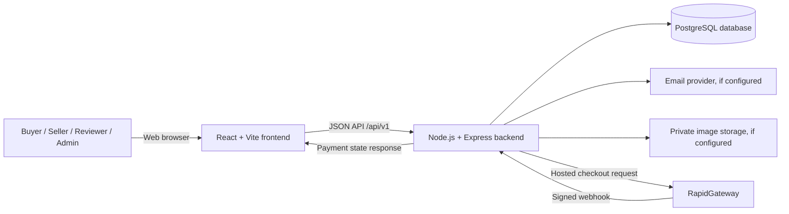

### 9.2 Buyer purchase flow

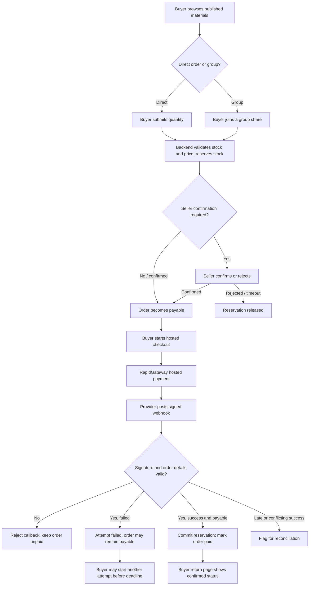

### 9.3 Seller onboarding and listing flow

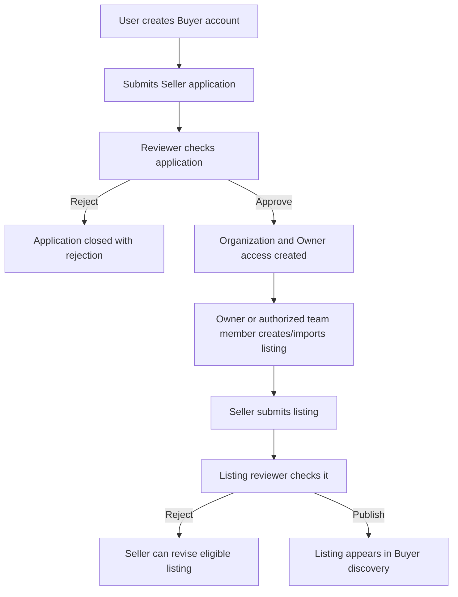

### 9.4 Suggested additional diagrams

- **Figure placeholder:** database entity relationship diagram for users, memberships, listings, requirements, orders, purchase groups, payment attempts, and audit events.
- **Figure placeholder:** deployment diagram for local development and hosted production services.
- **Optional chart:** use measured evaluation data, such as task completion time, test outcomes, or listing/order conversion. Do not chart fictional usage or impact.

## 10. Implementation and technology

| Layer             | Technology / responsibility                                                                                                            |
| ----------------- | -------------------------------------------------------------------------------------------------------------------------------------- |
| Frontend          | React 18, React Router, and Vite; renders public pages, forms, role-specific workspaces, and hosted payment return status.             |
| API               | Node.js and Express; validates inputs, authenticates sessions, enforces roles, and implements business workflows under `/api/v1`.      |
| Database          | PostgreSQL; stores accounts, organization membership, listings, requirements, orders, payment attempts, audit records, and migrations. |
| Image storage     | Optional private Supabase Storage integration for listing images; requires backend-only configuration.                                 |
| Email             | Optional SMTP/Gmail configuration for verification, reset, and invitation messages.                                                    |
| Payment provider  | RapidGateway hosted checkout. TEST and LIVE credentials are backend-only.                                                              |
| API documentation | Backend OpenAPI file at `docs/openapi.yaml`.                                                                                           |

The backend is a modular monolith: modules and services separate responsibilities while the application runs as one API service. Database migrations are versioned SQL files and applied through `npm run db:migrate` to whichever database `DATABASE_URL` selects.

### 10.1 Main backend areas

- Account registration, email verification, Google identity, sessions, and password recovery.
- Seller requests, reviewer permissions, organization teams, and invitations.
- Catalog listings, import validation, media metadata, search, and moderation.
- Buyer requirements and matching.
- Purchase/order state, stock reservations, group shares, and expiry.
- Payment attempts, RapidGateway checkout, signed webhook processing, and reconciliation.
- Analytics, settings, and scheduled maintenance.

### 10.2 API overview

The API is rooted at `/api/v1`. Key endpoint groups include:

| Group         | Representative endpoints                                                                                        |
| ------------- | --------------------------------------------------------------------------------------------------------------- |
| Auth          | `POST /auth/register`, `POST /auth/login`, `POST /auth/google`, `POST /auth/refresh`, `GET /auth/me`            |
| Seller review | `POST /seller/requests`, `GET /platform/seller-requests`, `POST /platform/seller-requests/{requestId}/decision` |
| Catalog       | `GET /listings`, `POST /organizations/{organizationId}/listings`, `POST /platform/listings/{listingId}/review`  |
| Requirements  | `POST /requirements`, `GET /requirements/{requirementId}/matches`                                               |
| Purchases     | `POST /orders`, `GET /orders/mine`, `POST /purchase-groups/{groupId}/contributions`                             |
| Payment       | `POST /orders/{orderId}/checkout`, `GET /payment-attempts/{attemptId}`, `POST /rapidgateway/webhook`            |
| Workspace     | `GET /analytics/buyer-impact`, `GET /organizations/{organizationId}/analytics`, `GET /platform/analytics`       |

See `docs/openapi.yaml` for the complete endpoint inventory, parameters, schemas, authentication, and responses. The repository `docs/backend-handoff.md` and `docs/frontend-handoff.md`, when included in the shared project, provide separate implementation inventories.

## 11. Payment module

The application uses a hosted redirect checkout. ReThread does not collect or store card numbers or OTP credentials. Before checkout, a Buyer must own an eligible order that is in `pending_payment`. The backend uses the order’s stored total, creates a payment attempt, and returns the provider checkout URL.

The Buyer completes the provider-hosted step and returns to `/payment/return`. The browser return does not prove payment. RapidGateway sends a server-to-server webhook to `POST /api/v1/rapidgateway/webhook`. The backend checks the raw-body HMAC-SHA256 signature and timestamp, validates the merchant, environment, currency, reference, and amount, and handles duplicate event IDs safely. A valid success received while the order is payable updates the payment attempt, order, inventory reservation, and audit history in a database transaction. Late or conflicting provider successes are flagged for reconciliation.

The local sandbox uses `RAPID_GATEWAY_MODE=TEST`; production LIVE mode requires separately issued live merchant credentials and signing salt. The team has observed a TEST checkout reach “Payment confirmed” after the signed notification. This is evidence of a sandbox flow only. It does not establish live provider approval, production deployment, refunds, payouts, or settlement.

Current payment boundaries: refund processing, refund callbacks, payout/settlement handling, fulfillment, and disputes are not implemented. See `docs/rapidgateway.md` for setup and safeguards.

## 12. Financial and operating model

The code implements marketplace ordering and hosted payment but **does not establish a final business revenue policy**. Do not state that the platform currently earns transaction fees or subscriptions unless the project team has approved that policy.

### 12.1 Options for team decision

Potential models to evaluate include:

1. **Transaction fee:** a clearly disclosed fee on completed orders. Requires agreement about which party pays, provider charges, tax treatment, refunds, and settlement.
2. **Seller subscription:** recurring listing or inventory-management access. Requires a plan for onboarding and ongoing seller value.
3. **Buyer/Seller service tiers:** optional paid tools such as bulk import, advanced reporting, or promoted listings. Avoid reducing fair access to basic marketplace use without a clear reason.
4. **Partner or institutional support:** grants, industry partnerships, or sponsored circularity programs. This is not predictable operating revenue until committed.

These are proposals for evaluation, not current features. The initial prototype has no implemented fee ledger, subscription billing, payout service, or settlement workflow.

### 12.2 Cost categories to estimate

| Cost area                     | Examples to include in a future estimate                                                                |
| ----------------------------- | ------------------------------------------------------------------------------------------------------- |
| Hosting                       | Frontend hosting, API hosting, database plan, backups, monitoring.                                      |
| Payment                       | Provider transaction charges, failed/refunded transaction costs, reconciliation operations.             |
| Storage and traffic           | Listing images, bandwidth, database growth, backups.                                                    |
| Operations                    | Seller verification, support, listing moderation, dispute handling, and onboarding.                     |
| Compliance and administration | Business, tax, privacy, and payment-provider requirements to be reviewed with qualified local advisers. |

**Financial analysis placeholder:** `[Add pricing assumptions, per-order example, operating-cost estimate, break-even estimate, and source/date for every external price.]` Do not include provider credentials or real bank/payment details.

## 13. Testing, results, and evaluation

The codebase contains unit/regression tests, PostgreSQL integration tests, and browser/e2e coverage. Previous project records document successful test runs for core catalog and purchase scenarios, but these records are dated and must be rechecked against the current branch before this report is finalized. See `docs/delivery-status.md`, `docs/verification-week-2.md`, and CI for recorded evidence.

### 13.1 Evaluation table to complete

| Test area                | What to verify                                                                     | Result / evidence to insert                           |
| ------------------------ | ---------------------------------------------------------------------------------- | ----------------------------------------------------- |
| Authentication and roles | Buyer, Owner, Manager, Staff, Reviewer, and Admin can access only allowed actions. | `[Pass/fail, test date, CI link or screenshot]`       |
| Seller onboarding        | Submit application, review decision, and organization Owner membership.            | `[Pass/fail and evidence]`                            |
| Catalog                  | Draft, submit, approve/reject, search published listing, and import validation.    | `[Pass/fail and evidence]`                            |
| Requirements             | Create, pause/resume/close, and check deterministic matches.                       | `[Pass/fail and evidence]`                            |
| Direct purchases         | Price snapshot, stock reservation, Seller decision, timeout, and release.          | `[Pass/fail and evidence]`                            |
| Group purchases          | Share limits, target/deadline, withdrawal, nonpayment, and reconfirmation.         | `[Pass/fail and evidence]`                            |
| Payment TEST success     | Hosted redirect, signed webhook, order marked paid, reservation committed.         | `[Pass/fail; label TEST; do not include credentials]` |
| Payment TEST failure     | Attempt becomes failed; order remains payable before its deadline.                 | `[Pass/fail and evidence]`                            |
| Payment recovery         | Duplicate event, late success, expired order, and reconciliation state.            | `[Pass/fail and evidence]`                            |
| Responsive behavior      | Required viewport sizes and main role-specific workflows.                          | `[Devices/sizes, pass/fail, screenshots]`             |

### 13.2 Metrics for a user study

If you run user testing, report the participant count and selection method, tasks, completion rate, time on task, errors, and participant feedback. Keep personal data anonymous. Do not infer market-wide demand from a small convenience sample.

## 14. Screenshots and figure placeholders

The following screenshots were supplied in the project root `Screenshots/` folder. Each caption gives a one-line description. Some images show account emails, names, organization data, or payment values; redact those details before sharing the report outside the team.

### 14.1 Screenshots provided

**Figure 1 — ReThread home page:** Introduces the textile surplus marketplace and links to browsing, how it works, and sign-in.  
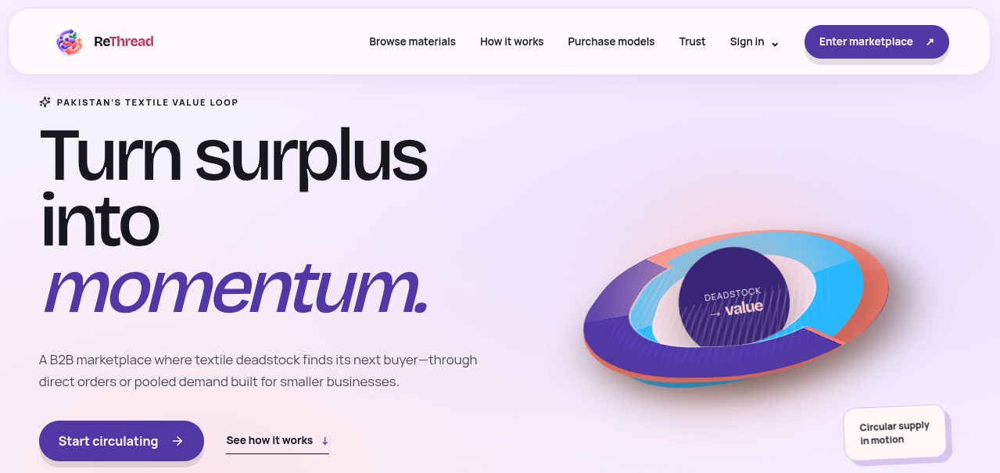

**Figure 2 — Buyer overview:** Shows the Buyer workspace navigation and live order summary cards, which are zero in this captured database state.  

**Figure 3 — Buyer profile:** Shows personal account details, local view preferences, and the password reset entry point.  
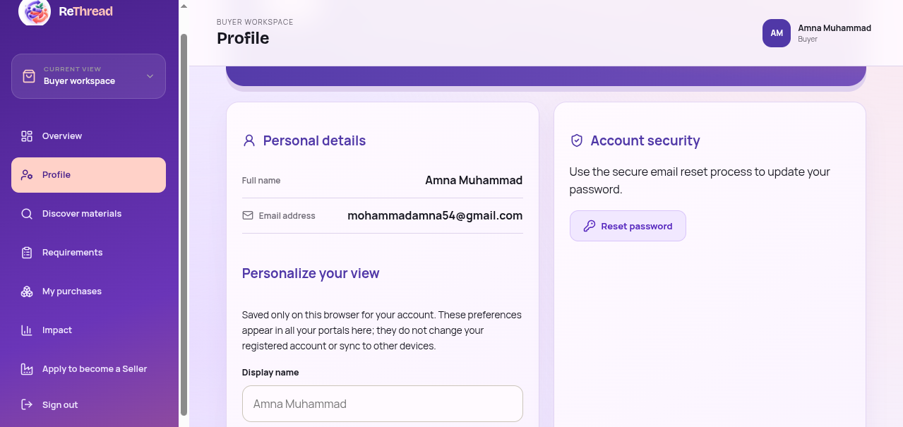

**Figure 4 — Discover materials:** Shows Buyer search filters and a published textile listing with available quantity, minimum order quantity, and price.  
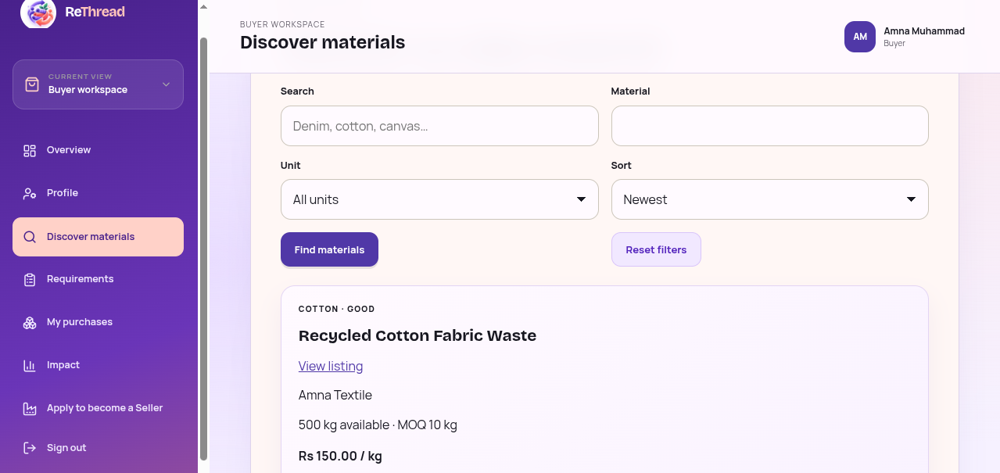

**Figure 5 — Invited Manager sign-in:** Shows the organization invitation sign-in form and role choice for Manager or Staff.  
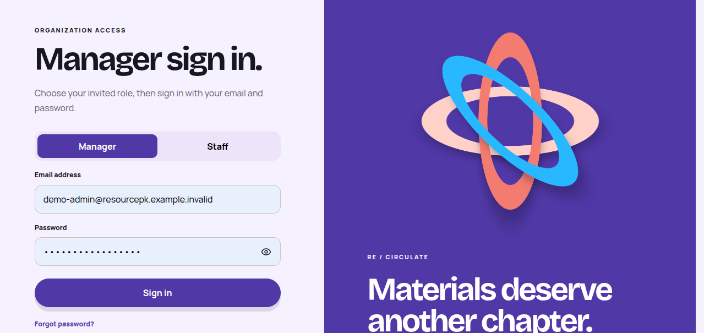

**Figure 6 — Platform overview:** Shows platform-level operational counts and recorded paid value for the captured database.  
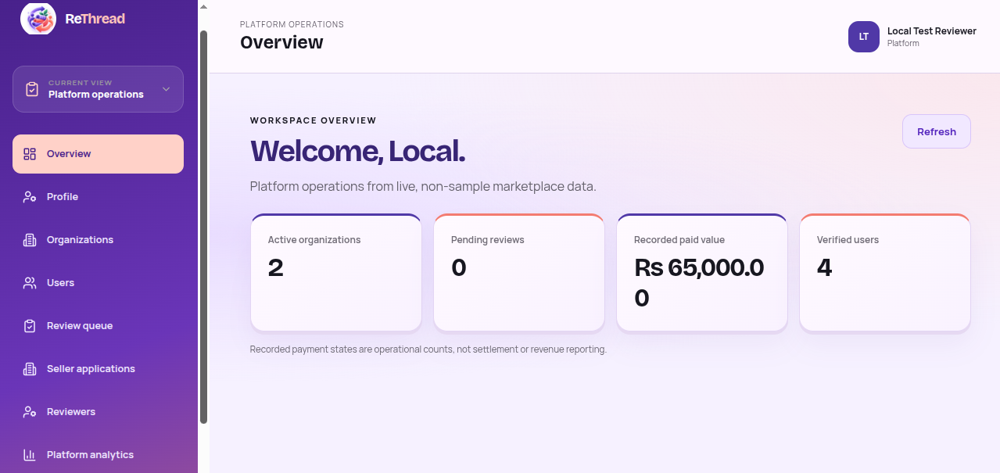

**Figure 7 — Organization directory:** Shows the platform directory with organization status, membership, and listing counts.  
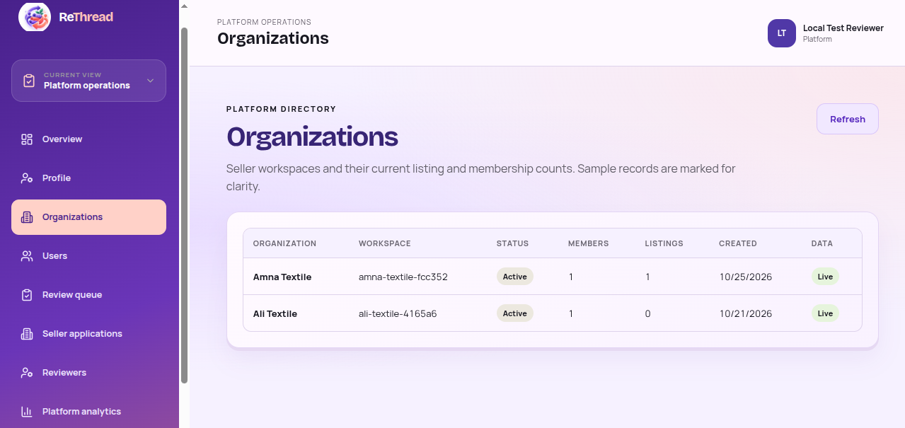

**Figure 8 — Reviewer management:** Shows the Admin form for inviting reviewers and granting application-review or listing-review permissions.  
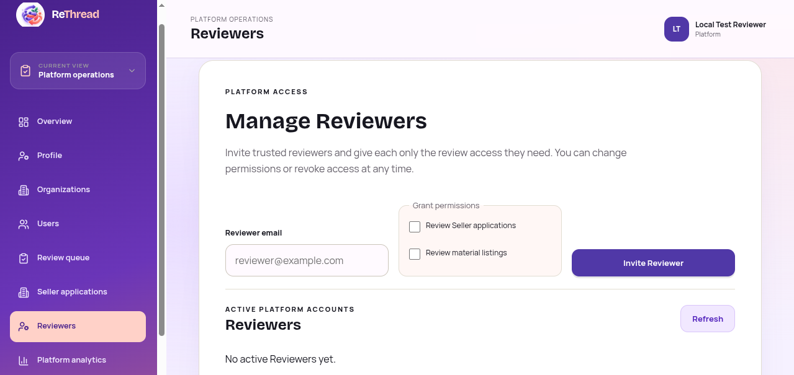

**Figure 9 — Seller overview:** Shows the organization workspace navigation and Seller listing/order summary cards.  
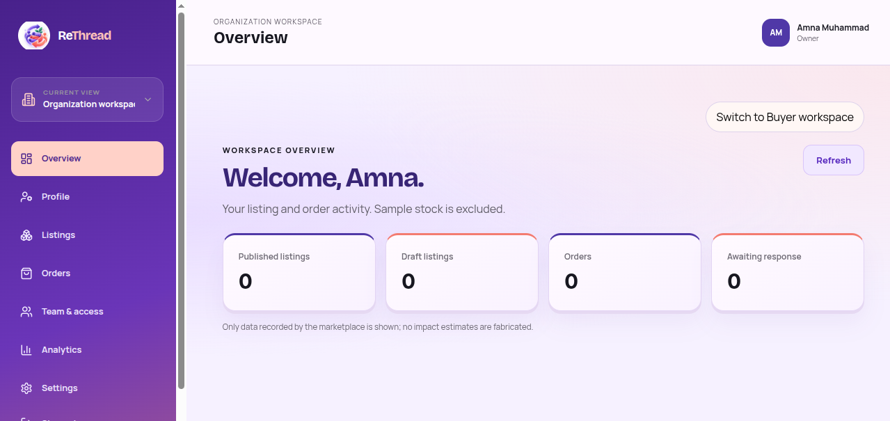

**Figure 10 — Create material listing:** Shows the Seller form for entering textile details, stock, minimum quantity, and price.  
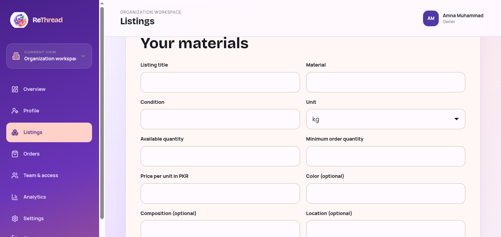

### 14.2 Screenshots still to add

Add these only if you capture the corresponding implemented flows:

- **Figure 11 — Buyer requirements:** `[Screenshots/requirements.png]` — Shows a Buyer’s material request and matching results.
- **Figure 12 — Listing detail or purchase form:** `[Screenshots/listing-detail.png]` — Shows the selected material, price tiers, and order action.
- **Figure 13 — My purchases and checkout:** `[Screenshots/my-purchases.png]` — Shows order state and checkout entry point.
- **Figure 14 — Hosted payment sandbox:** `[Screenshots/payment-test.png]` — Label clearly as RapidGateway TEST; no real payment was processed.
- **Figure 15 — Payment return:** `[Screenshots/payment-return.png]` — Shows backend-confirmed payment state after the signed webhook.
- **Figure 16 — Mobile layout:** `[Screenshots/mobile-view.png]` — Shows one implemented workflow at a phone viewport.

Do not use a screenshot to claim that a feature is complete unless the corresponding working flow exists in the current application.

## 15. Limitations, risks, and future work

### 15.1 Current limitations

- The platform does not manage shipment, delivery, or physical inspection of material.
- Refunds, payouts, settlement, disputes, and reviews are not implemented.
- Payment success depends on a correctly configured and reachable provider webhook; local sandbox success is not live payment acceptance.
- Image storage and email sending require separate service configuration and hosted verification.
- No measured environmental impact should be claimed from the current screens without an agreed calculation method and real transaction data.
- Market demand, seller supply, pricing, and revenue assumptions require user research.
- Older planning/status documents may not reflect later implementation; verify claims against the current code, OpenAPI contract, and current CI.

### 15.2 Future work

1. Complete hosted deployment acceptance for email, storage, backups, and monitoring.
2. Complete wider browser, accessibility, load, and security testing.
3. Build fulfillment, cancellation, refund, payout, settlement, and dispute workflows with auditable states.
4. Add verified order-linked reviews and messaging if required by user research.
5. Improve analytics only after defining metric formulas and data quality controls.
6. Conduct buyer and seller usability research in Pakistan and validate local alternatives.
7. Decide and validate a revenue model, including provider costs and operational responsibilities.

## 16. Conclusion

ReThread is a working marketplace prototype for textile surplus exchange, with buyer discovery, seller approval, moderated listings, requirements, direct and group orders, role-aware workspaces, and a hosted payment integration in sandbox mode. Its principal contribution is combining these workflows in a Pakistan-focused product concept. The implementation provides technical foundations for structured discovery and transaction records, but does not yet prove adoption, waste reduction, profitability, or live payment readiness. Those outcomes require user research, real operational data, and further deployment and product work.

## 17. References

Use the required citation style from your institution. These sources were consulted for the current draft; check them again before submission and add access dates if required.

1. Ministry of Climate Change and Environmental Coordination, Government of Pakistan. “Musadik Malik Highlights Pakistan's Role in Circular Economy, Used Textiles Trade for environmental sustainability.” 16 April 2025. [Ministry source](https://mocc.gov.pk/NewsDetail/YzJhZTJjMTUtYmRjNy00MmNiLWE5YTYtYjhhMmJmZDI4MmQ0)
2. Queen of Raw / Material MX. “Excess Inventory Software — Recycle, Buy and Sell Online.” [https://abi.queenofraw.com/](https://abi.queenofraw.com/)
3. FABSCRAP. “Fabric & Textile Recycling Resources.” [https://fabscrap.org/resources](https://fabscrap.org/resources)
4. Abdul Rehman. _Textile / Legacies: Mapping the Sustainable Fashion Ecosystem in Pakistan_. British Council Pakistan, January 2025. [Report PDF](https://www.britishcouncil.pk/sites/default/files/textile_legacies_report.pdf)
5. Reverse Resources, National Textile University, and KnowTex. _Comprehensive Overview of the Pakistan Textile Waste Industry_. SMEP Programme, March 2025. [Report page and download](https://smepprogramme.org/resources-1/comprehensive-overview-of-the-pakistan-textile-waste-industry/)
6. SMEP Programme. “Textile Waste Traceability: Using data to revolutionise textile waste management and recycling.” [Project page](https://smepprogramme.org/project/reverse-resources/)
7. Muhammad Zeeshan Younas. “A Spatial Agglomeration Analysis of Firm Productivity: A Case of the Textile Sector of Pakistan.” _The Lahore Journal of Economics_, 27(1), 2022. [Article](https://nja.pastic.gov.pk/journals/index.php/LJE/article/view/17389)
8. RapidGateway. “Payment Webhooks: Integration & Signature Verification Guide.” **[Add exact provider guide URL used by the team before final submission.]**
9. ReThread backend project documentation. OpenAPI contract, architecture, current feature scope, RapidGateway guide, and verification records in the project repository. **[Add repository URL and commit hash for the evaluated version.]**
10. ReThread frontend project repository and release/commit used for screenshots. **[Add repository URL and commit hash.]**

> Verify all links and source claims before final release. Add research papers or government/industry statistics only when they directly support a statement in the report.

## 18. Appendices

### Appendix A — Project team and academic details

- Institution: `[Insert]`
- Department/program: `[Insert]`
- Supervisor: `[Insert]`
- Team members and responsibilities: `[Insert]`
- Submission date and version: `[Insert]`

### Appendix B — Environment and secret handling

Document variable names and safe setup steps only. Never include actual `.env` contents, database connection strings, OAuth secrets, webhook signing salts, passwords, or service-role keys. The backend migrations apply to the database selected by `DATABASE_URL`; confirm the target before running them.

### Appendix C — Glossary

| Term                | Meaning in this report                                                                        |
| ------------------- | --------------------------------------------------------------------------------------------- |
| Deadstock / surplus | Usable textile material that is excess to a seller’s current production or inventory needs.   |
| Buyer requirement   | A record of material needs used to find potential published listing matches.                  |
| Direct order        | One Buyer’s order from an available listing.                                                  |
| Group purchase      | A seller-defined purchase opportunity where multiple Buyers reserve separate shares.          |
| Webhook             | A server-to-server notification from the payment provider about an event.                     |
| Reconciliation      | Reviewing a payment event whose result conflicts with the order’s current state.              |
| Sandbox             | Provider test environment where payment outcomes are simulated and no real funds should move. |
